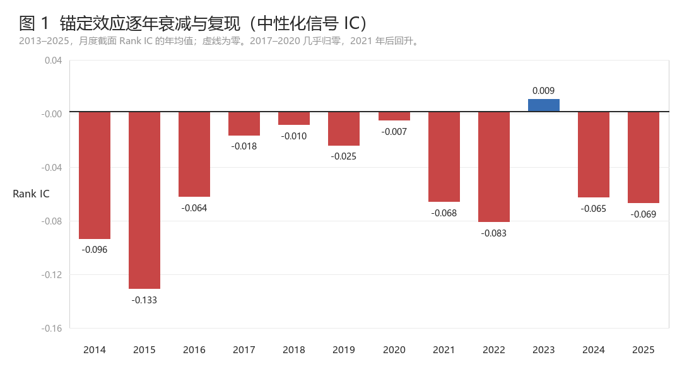
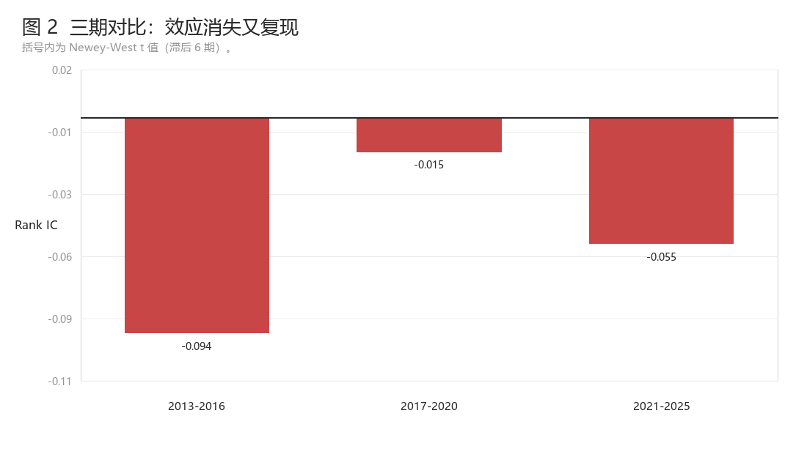
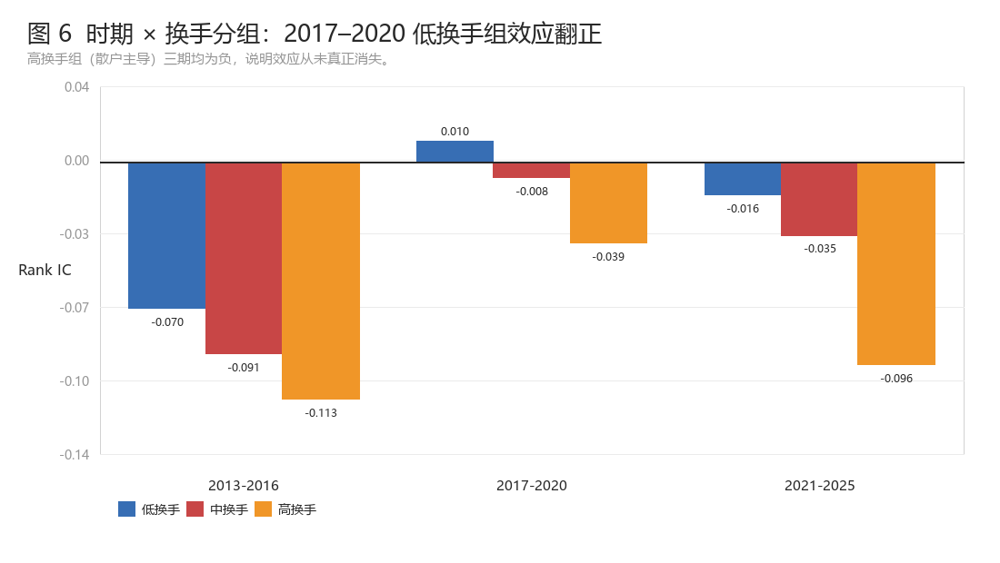
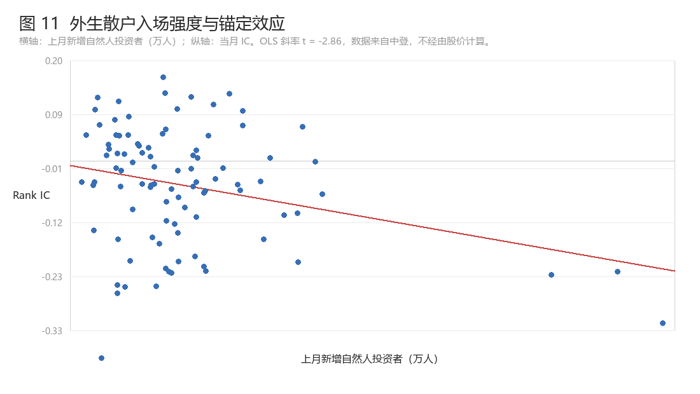

# A-Share Anchoring Factor

**When a behavioural story survives but the factor does not.**

[中文版](README.md) · [Full report (Chinese, 20 pp.)](reports/report_zh.pdf)

---

## TL;DR

Can the anchoring / disposition effect — retail investors selling against a **historical reference
price** rather than fundamental value — be turned into a tradable cross-sectional factor in China's
A-share market?

I build four price-anchor signals on 13.3 million daily observations (5,831 stocks, 2013–2025,
156 months) and push them through the whole chain: raw IC → industry/size neutralisation →
orthogonalisation against reversal and momentum → costed long-short backtest.

**The effect is real. It is the opposite sign to the US literature. It is a retail phenomenon.
And it is not a factor.**

| Test | Result | Verdict |
|---|---|---|
| Four anchors, raw | IC −0.036 to −0.086, all negative | Direction is unambiguous |
| Industry + size neutralised | IC −0.052, Newey-West t = **−4.93** | Cleaner, not weaker |
| **+ orthogonalised vs reversal & momentum** | IC **−0.006**, t = **−0.88** | **Signal gone** |
| Costed long-short, quarterly, 50 bp | net Sharpe 0.27 | Not investable |

The cross-sectional spread this signal earns is, to a first approximation, the spread that
short-term reversal and momentum were already earning.

---

## Three results worth reading on their own

### 1. The sign is the opposite of the US

Riley & Zhou (2026) find that US stocks with a concentrated base of *unrealised gains* subsequently
**outperform** — holders are reluctant to sell, supply contracts. In A-shares the sign flips:
stocks with the largest unrealised gains **underperform**. "Take the profit" dominates "let it run".

The sign held for four different anchors over twelve years without a single reversal.


*Yearly mean rank IC of the neutralised VWAP120 signal, 2014–2025. Zero line drawn. The effect nearly
vanishes in 2017–2020 and returns afterwards.*

### 2. It disappears and comes back — it does not decay

Three sub-periods:

| Period | Months | IC | NW t |
|---|---|---|---|
| 2013–2016 | 37 | −0.0936 | −4.62 |
| 2017–2020 | 48 | −0.0149 | −1.45 |
| 2021–2025 | 59 | −0.0548 | −4.71 |

A trend regression gives b = +0.00026/month, t = **+1.11** — no decay.

This rejects the appealing story that Chinese retail investors "learned their lesson" after several
bull-bear cycles. Learning would imply monotone convergence to zero. What we see is a U-shape:
**state dependence, not parameter drift.**


*Mean IC by sub-period. A U-shape, not a decay path.*

### 3. It is a retail phenomenon, and its strength tracks retail participation

Sorting on lagged turnover: **−0.021 / −0.040 / −0.081** for low / mid / high — perfectly monotone.
Sorting on market cap: −0.070 / −0.063 / −0.030.

More tellingly, the 2017–2020 disappearance happens *only* in the low-turnover (institution-heavy)
group, which flips positive (+0.010). The high-turnover group never stops working (−0.039, t = −2.9).


*IC by sub-period and turnover tercile. Only the institution-heavy tercile dies.*

Median market monthly turnover across the three periods was **38.3% / 27.1% / 36.1%** — the trough
lines up exactly with the four dead years.

#### Guarding against the obvious objection

Turnover is computed from prices, so "high turnover ⇒ stronger effect" could be mechanical.
To rule this out I use **ChinaClear (CSDC) investor data**, which never touches the price series:

| Proxy | Price-derived? | b | t | 1 SD impact |
|---|---|---|---|---|
| **New retail investors** | No | −0.0005 | **−2.86** | −0.033 |
| Average trade size (10k CNY) | No | +0.0056 | +1.07 | +0.011 |
| Transfer count | No | — | +0.16 | +0.002 |
| Market turnover (control) | Yes | −0.163 | −3.25 | −0.030 |

New retail account openings carry essentially the same explanatory power as market turnover
(−0.033 vs −0.030) while being fully exogenous to prices. Average trade size tells the same story
with a weaker t-statistic: it peaked at **7.74** 万/笔 in 2017–2020 (largest tickets, most institutional)
— precisely the dead years — and fell to **4.60** in 2021–2025 as retail returned.


*Lagged new retail investors (10k) against contemporaneous IC. Slope t = −2.86.*

---

## Why publish a negative result

Most quant portfolios show only what worked. The value here is that a plausible idea was pushed all
the way to a verdict and closed honestly:

- **Mechanism-level contribution.** Clean evidence that the sign is opposite to the US, plus an
  observable, non-price driver of behavioural-factor strength.
- **Methodological discipline on display.** The orthogonalisation gate, Newey-West correction, and
  the record of a *sub-sample result being overturned by a longer sample* are all documented. The
  2021–2025 subsample first suggested a surviving residual (IC −0.035, t ≈ −2); at 144 months it was gone.
- **Implication for A-share quant.** If behavioural factors load on retail participation, then the
  post-2021 rebound in turnover means these factors are *re-arming*, not permanently dead.

Full report (Chinese, 20 pages, 10 tables, 11 figures): [`reports/report_zh.pdf`](reports/report_zh.pdf)

> Figure captions inside the PNGs are in Chinese to match the report. English captions are given
> under each figure above.

---

## Repository layout

```
a-share-anchoring/
├── src/
│   ├── loader.py      CSMAR / CSDC loading & cleaning (configurable, recursive)
│   ├── anchors.py     four price anchors and signal construction
│   ├── factor.py      panel build, neutralisation, backtest, turnover
│   └── stats.py       rank IC, Newey-West t, cross-sectional slope, trend test
├── scripts/
│   ├── 01_build_cache.py          clean raw CSVs and cache
│   ├── 02_main_results.py         neutralisation / orthogonalisation / backtest (Tables 2–4)
│   ├── 03_time_variation.py       yearly, sub-period, rolling, trend (Table 5)
│   ├── 04_retail_participation.py heterogeneity and time series (Tables 6–7)
│   ├── 05_exogenous_validation.py CSDC exogenous test (Tables 9–10)
│   ├── 06_make_figures.py         11 figures + assets.json
│   └── 07_build_report.py         assemble the Word/PDF report
├── reports/            report PDF, source, 11 figures
├── data/               data placeholder (raw data is licensed, not committed)
└── docs/RESULTS.md     every headline number in one table
```

## Data

Raw data comes from **CSMAR** and **ChinaClear** and is licensed — it is **not** in this repository.
You need to supply:

| File pattern | Content | Used for |
|---|---|---|
| `TRDNEW_Dalyr*.csv` | Daily quotes: back-adjusted close, volume, float market cap, trading status | Prices and anchors |
| `STK_ITEMCHANGE*.csv` | Listing-status changes | ST filter, delisting dates |
| `STK_LISTEDCOINFOANL*.csv` | Company info: industry code, listing date | Industry neutralisation |
| `QX_CSDC*.csv` | CSDC main indicators: transfer count and amount | Average trade size |
| `QX_InvestorM*.csv` | Investor statistics: new retail investors | Exogenous retail proxy |

Drop them into `data/raw/` (any sub-folder naming works — the loader searches recursively), or point
the loader elsewhere:

```bash
export ANCHOR_DATA_ROOT=/path/to/csmar_export    # Windows: set ANCHOR_DATA_ROOT=...
export ANCHOR_CACHE=/path/to/prices.pkl
```

> ⚠️ Two traps that will silently destroy the study — both handled in code, both worth knowing:
>
> 1. **Use back-adjusted prices.** Unadjusted prices halve mechanically on a 10-for-10 split, fabricating
>    a "deeply underwater" signal — and precisely on high-split growth stocks, so the artefact looks
>    highly significant in a backtest.
> 2. **`Dsmvosd` (float market cap) is in thousands of CNY** while turnover is in CNY. The denominator
>    needs `× 1000`, otherwise turnover is off by three orders of magnitude.

## Reproduce

```bash
pip install -r requirements.txt

python scripts/01_build_cache.py            # ~3–5 min, writes the cache
python scripts/02_main_results.py           # Tables 2–4
python scripts/03_time_variation.py         # Table 5
python scripts/04_retail_participation.py   # Tables 6–7
python scripts/05_exogenous_validation.py   # Tables 9–10
python scripts/06_make_figures.py           # 11 figures
python scripts/07_build_report.py           # Word report (convert to PDF with LibreOffice)
```

## Method

- **Anchors.** `g = P/A − 1`, with A ∈ {52-week high, 750-day high, 120-day VWAP, 250-day VWAP}.
  A ratio is dimensionless and comparable across stocks with different price levels and share counts.
- **Neutralisation.** 1%/99% winsorise → cross-sectional regression on industry dummies and log float
  market cap → take residuals.
- **Orthogonalisation.** On top of that, residualise against 1-month reversal and 12-1 momentum.
  This is the gate that decides whether a "new factor" is just a repackaging of old ones.
- **Inference.** Monthly rank IC; all time-series conclusions use Newey-West t with 6 lags, because
  monthly IC is autocorrelated.
- **Portfolio.** Long Q1 / short Q5, equal weight, turnover from name changes, 30 and 50 bp one-way costs.

## Limitations

- The costed backtest covers 2021–2025 only; earlier years were not backtested.
- VWAP uses daily prices, not intraday weighting.
- CSDC data ends 2023-08, missing 2024–2025 — the period where the effect recovered most.
- No limit-up/limit-down or suspension filters, no short-selling fees or borrow availability;
  live performance would be worse than the backtest.
- Sentiment proxies built from prices are endogenous; the CSDC test mitigates but does not fully solve this.

## References

Full list of 18 in §8 of the report. Key ones:

1. Grinblatt, M., & Han, B. (2005). Prospect theory, mental accounting, and momentum. *JFE*, 78(2), 311–339.
2. Riley, C., & Zhou, Y. (2026). Shareholder-weighted returns and stock return predictability. *IRFA*, 118, 105367.
3. George, T. J., & Hwang, C.-Y. (2004). The 52-week high and momentum investing. *Journal of Finance*, 59(5), 2145–2176.
4. Bordalo, P., Gennaioli, N., La Porta, R., & Shleifer, A. (2025). Finance without exotic risk. *JFE*, 173, 104145.
5. Newey, W. K., & West, K. D. (1987). A simple, positive semi-definite, heteroskedasticity and autocorrelation consistent covariance matrix. *Econometrica*, 55(3), 703–708.

## License

Code under MIT (`LICENSE`). Report text and figures under CC BY-NC 4.0.
Raw data remains the property of CSMAR and the respective data providers.

## Citation

```
@misc{ashare_anchoring_2026,
  title  = {A-Share Anchoring Factor: When a Behavioural Story Survives but the Factor Does Not},
  author = {Zhan, Changxu},
  year   = {2026},
  note   = {Working paper / independent research},
  url    = {https://github.com/Elysia-Z-13/a-share-anchoring}
}
```
