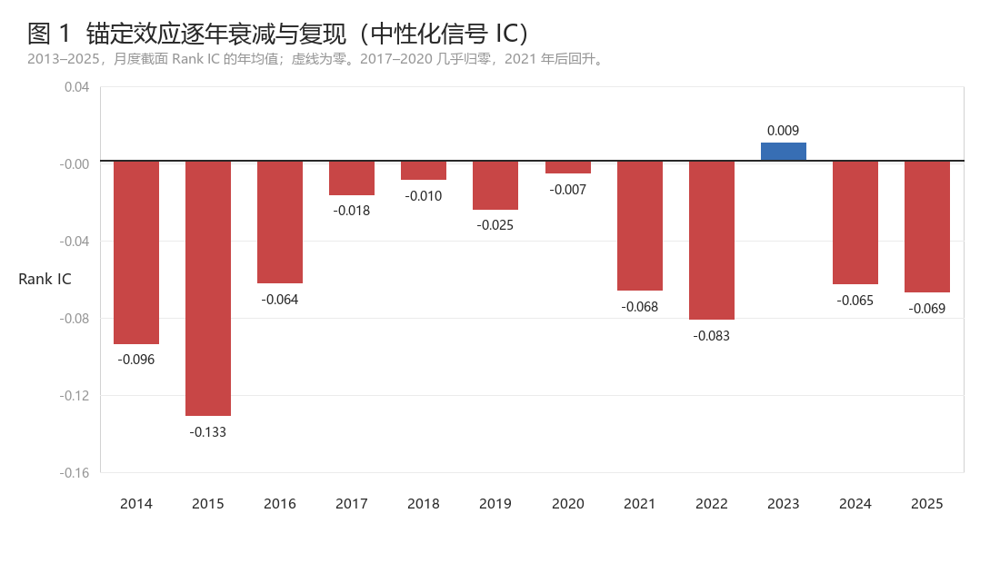
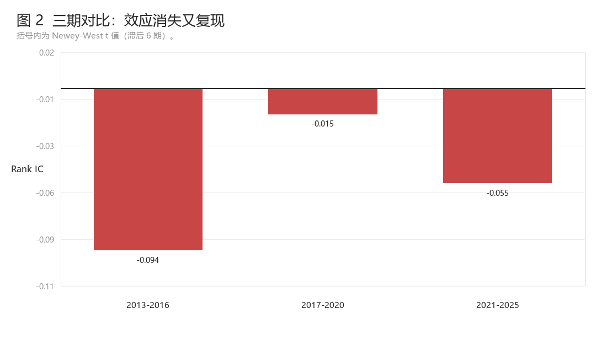
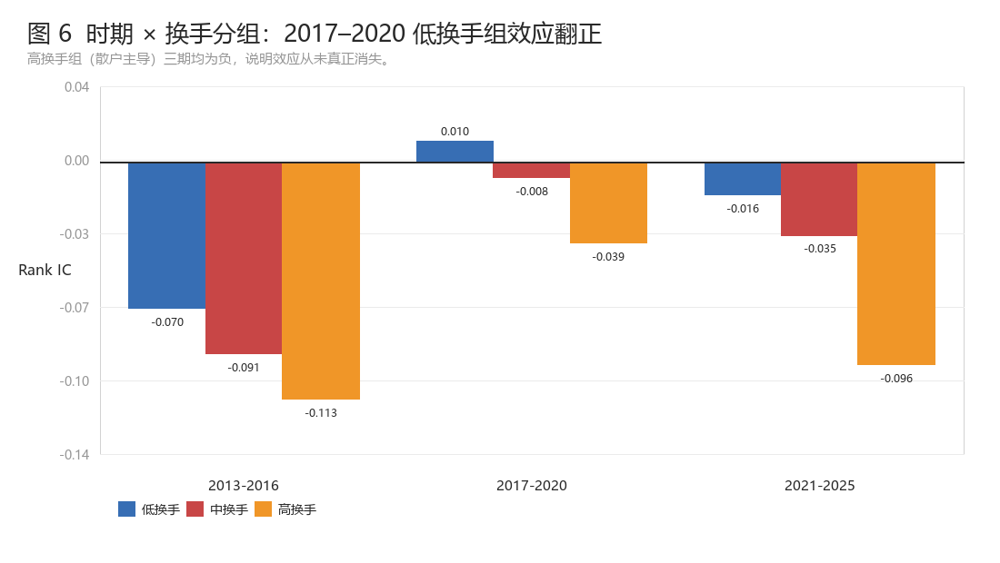
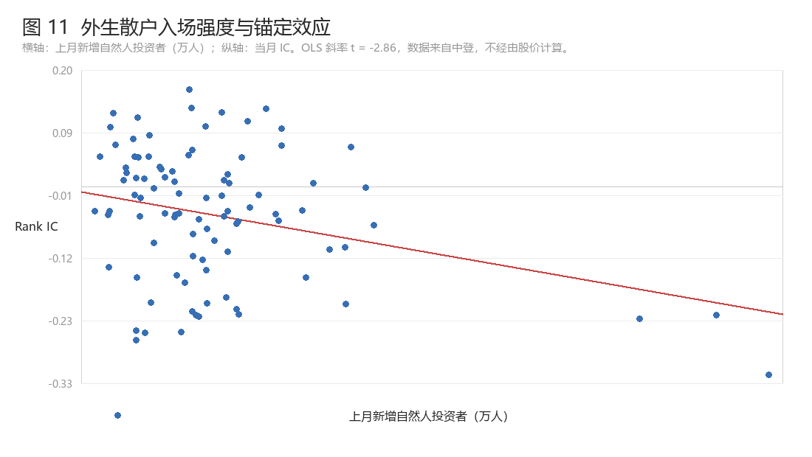

# A-Share Anchoring Factor — When a Behavioural Story Survives but the Factor Does Not

📄 **[English README](README.en.md)** · 中文版即本页

**English abstract.** Can the anchoring / disposition effect — retail investors selling against a historical
reference price rather than fundamental value — be turned into a tradable cross-sectional factor in China's
A-share market? Using 13.3 million daily observations on 5,831 stocks (2013–2025, 156 months), I build four
price-anchor signals and test them against reversal and momentum. The effect is real, is the *opposite sign*
to the US literature, and is concentrated in high-turnover small caps — but after industry/size neutralisation
and orthogonalisation against reversal and momentum, the information content collapses (IC −0.006, t = −0.88).
**The mechanism holds; the factor does not.** The project's second contribution is a state-dependence finding:
the effect vanished in 2017–2020 and returned in 2021–2025, tracking retail participation — validated with
exogenous ChinaClear account-opening data.

---

## 核心结论

| 检验 | 结果 | 判定 |
|---|---|---|
| 四个价格锚的原始信号 | IC −0.036 ~ −0.086，符号全部为负 | 方向确凿 |
| 行业 + 市值中性化 | IC −0.052，Newey-West t = **−4.93** | 更干净 |
| **再对反转 + 动量正交化** | IC **−0.006**，t = **−0.88** | **信号消失** |
| 扣费后组合（季频、50bp） | 净 Sharpe 0.27 | 不可配置 |

一句话：**锚定效应在 A 股真实存在，但它赚到的钱，短期反转与动量早就赚走了。**

## 三个值得单独看的结果

**1. 符号与美股相反。** Riley & Zhou (2026) 在美股发现浮盈筹码集中者后续跑赢（惜售主导）；
A 股是浮盈者跑输（落袋为安主导）。四个锚、十二年，符号一次都没翻转。



**2. 效应是「消失又复现」，不是「衰减」。** 这否定了「散户经历多次牛熊后学乖了」的假说——
如果是学习，IC 应单调向零收敛；实际是 U 型，趋势检验 t = 1.11。



**3. 它是一种散户现象，且强度随散户参与度起落。** 按换手率三分组：低 −0.021 / 中 −0.040 / 高 −0.081，
完全单调；2017–2020 的消失只发生在机构主导的低换手组（翻正 +0.010），高换手组始终为负。



为排除「换手率本身来自价格、结论可能机械」的质疑，用**中国结算的投资者开户数**做外生验证——
该变量完全不经过股价计算，结果 t = **−2.86**，冲击量级与市场换手率几乎相同。



## 为什么这个「负结果」值得写

量化研究里容易只展示成功。这个项目的价值恰恰在于把一条看起来很有希望的路走到底并诚实收尾：

- **机制层面有增量**：给出了 A 股与美股符号相反的干净证据，以及「行为因子强度绑定散户参与度」这一可观测驱动变量。
- **方法层面可复用**：正交化门槛、Newey-West 修正、子样本推翻大样本的过程被完整记录——早期 2021–2025 子样本曾给出「残差 IC −0.035、t≈−2 存活」的假象，样本补到 144 个月后被推翻。
- **对整个 A 股量化的含义**：若行为因子随散户参与度起落，那么 2021 年后换手率回升意味着这类因子是**重新有效**而非永久消亡。

完整中文报告：[`reports/report_zh.pdf`](reports/report_zh.pdf)（20 页，10 表 11 图）

## 仓库结构

```
a-share-anchoring/
├── src/
│   ├── loader.py      CSMAR / 中登数据加载与清洗（路径可配置，递归查找分卷）
│   ├── anchors.py     四个价格锚与信号构造
│   ├── factor.py      面板构建、行业市值中性化、组合回测、换手率
│   └── stats.py       Rank IC、Newey-West t、横截面斜率、趋势检验
├── scripts/
│   ├── 01_build_cache.py          行情清洗与缓存
│   ├── 02_main_results.py         中性化 / 正交化 / 回测（表 2–4）
│   ├── 03_time_variation.py       逐年、分期、滚动、趋势（表 5）
│   ├── 04_retail_participation.py 散户异质性与时序（表 6–7）
│   ├── 05_exogenous_validation.py 中登外生验证（表 9–10）
│   ├── 06_make_figures.py         11 张图 + assets.json
│   └── 07_build_report.py         组装 Word/PDF 报告
├── reports/           报告 PDF、源文件、11 张图
├── data/              数据占位说明（原始数据不入库）
└── docs/RESULTS.md    全部关键数字
```

## 数据

原始数据来自 **CSMAR**（中国证券市场与会计研究数据库）与**中国结算**，受许可协议约束，**不入库**。
仓库只保留加载与清洗代码。需要自备：

| 文件 | 内容 | 用途 |
|---|---|---|
| `TRDNEW_Dalyr*.csv` | 日行情：后复权收盘价、成交量、流通市值、交易状态 | 价格与锚 |
| `STK_ITEMCHANGE*.csv` | 上市状态变更 | ST 过滤、退市时点 |
| `STK_LISTEDCOINFOANL*.csv` | 公司基本信息：行业、上市日期 | 行业中性化 |
| `QX_CSDC*.csv` | 中登主要指标：过户笔数、过户总金额 | 笔均成交金额 |
| `QX_InvestorM*.csv` | 投资者情况：新增自然人投资者 | 外生散户代理 |

把文件放到 `data/raw/`（支持任意子目录命名），或用环境变量指定：

```bash
export ANCHOR_DATA_ROOT=/path/to/csmar_export   # Windows: set ANCHOR_DATA_ROOT=...
export ANCHOR_CACHE=/path/to/prices.pkl
```

> ⚠️ 两个容易致命的细节，代码里已处理但值得知道：
> 1. **必须用后复权价**。未复权价在 10 送 10 时会机械腰斩，凭空造出「深度套牢」的假信号，而这些假信号恰好集中在高送转成长股上，回测时会「非常显著」。
> 2. **`Dsmvosd`（流通市值）单位是千元**，而成交额是元，算换手率时分母要乘 1000。

## 复现

```bash
pip install -r requirements.txt

python scripts/01_build_cache.py            # 约 3–5 分钟，生成缓存
python scripts/02_main_results.py           # 表 2–4
python scripts/03_time_variation.py         # 表 5
python scripts/04_retail_participation.py   # 表 6–7
python scripts/05_exogenous_validation.py   # 表 9–10
python scripts/06_make_figures.py           # 11 张图
python scripts/07_build_report.py           # 组装 Word 报告（再用 LibreOffice 转 PDF）
```

## 方法要点

- **锚**：`g = P/A − 1`，A 取 52 周高点、750 日高点、120/250 日成交量加权均价（VWAP）。比值无量纲，可横截面比较。
- **中性化**：1%/99% 截尾 → 申万行业哑变量 + ln(流通市值) 横截面回归取残差。
- **正交化**：在中性化残差上再对 1 个月反转与 12-1 动量回归取残差。这是判断「新因子是否为旧因子马甲」的必要步骤。
- **统计**：月度 Rank IC；时序结论一律以 Newey-West（滞后 6 期）t 值为准，因为月度 IC 序列存在自相关。
- **组合**：做多 Q1、做空 Q5，等权，按名单变动计换手，双边 30/50bp 两档成本。

## 局限

- 回测部分仅覆盖 2021–2025，更早年份的组合与成本分析未做。
- VWAP 用日频价格近似，未做日内加权。
- 中登数据止于 2023-08，恰好错过效应回升最快的 2024–2025。
- 未考虑涨跌停与停牌的可成交性过滤、融券成本与券源约束，实盘表现会进一步低于回测。
- 情绪代理若来自价格则存在内生性，本仓库用中登数据部分缓解但未完全解决。

## 参考文献

完整 18 条见报告第 8 节。核心几篇：

1. Grinblatt, M., & Han, B. (2005). Prospect theory, mental accounting, and momentum. *JFE*, 78(2), 311–339.
2. Riley, C., & Zhou, Y. (2026). Shareholder-weighted returns and stock return predictability. *IRFA*, 118, 105367.
3. George, T. J., & Hwang, C.-Y. (2004). The 52-week high and momentum investing. *Journal of Finance*, 59(5), 2145–2176.
4. Bordalo, P., Gennaioli, N., La Porta, R., & Shleifer, A. (2025). Finance without exotic risk. *JFE*, 173, 104145.
5. Newey, W. K., & West, K. D. (1987). A simple, positive semi-definite… covariance matrix. *Econometrica*, 55(3), 703–708.

## 许可

代码以 MIT 许可发布（见 `LICENSE`）；报告文本与图表以 CC BY-NC 4.0 发布。原始数据版权归 CSMAR 与各数据提供方所有，不在本仓库范围内。
